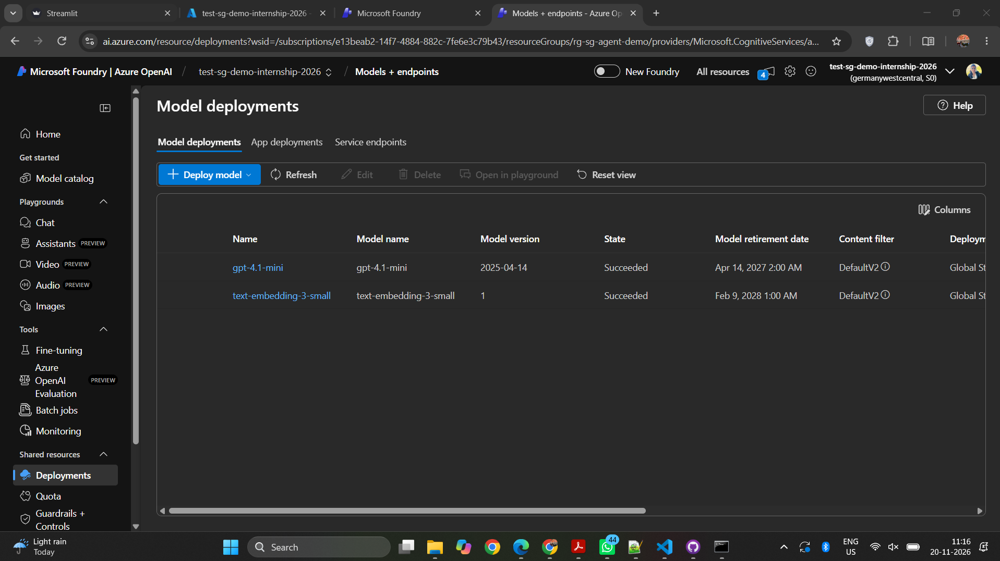
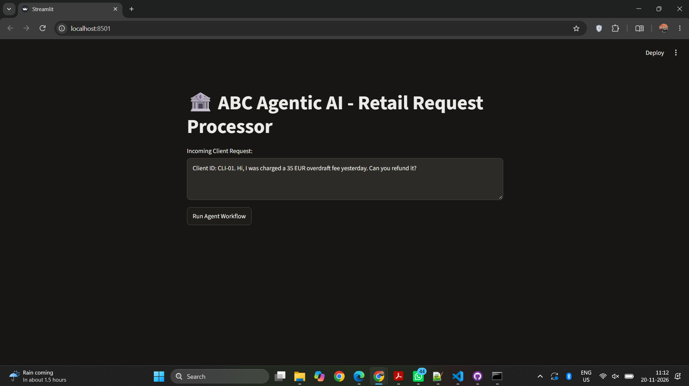
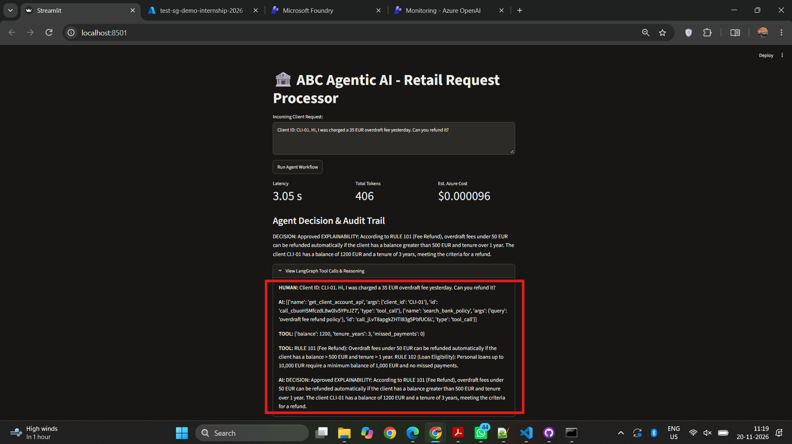
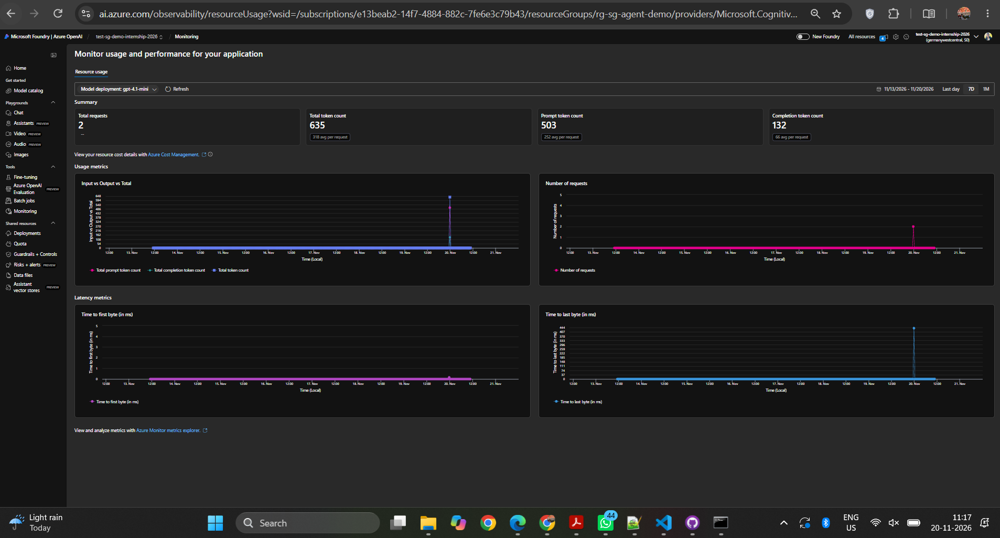
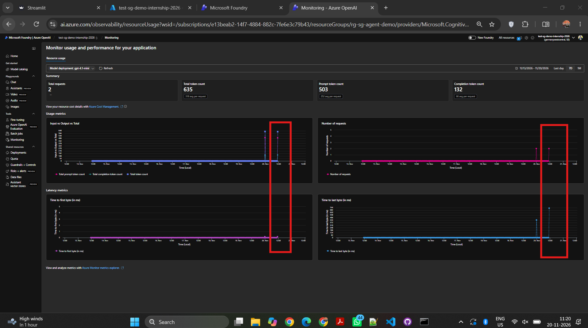

# 🏦 Retail Banking Agentic AI Assistant (Azure + LangGraph + RAG)

An end-to-end **Agentic AI prototype** designed to automate retail banking customer requests (fee refunds, loan eligibility, and risk escalations). Built with **LangGraph**, **LangChain**, **Azure OpenAI**, and **Streamlit**, this application demonstrates how multi-step AI agents can safely orchestrate internal API calls and policy retrieval while enforcing strict auditability and cost monitoring.

---

## 🎯 Project Motivation & Banking Use Case

In retail banking operations, incoming customer requests arrive in unstructured formats (emails, messages) and require cross-referencing internal policies with real-time client account metrics. 

This project addresses three core enterprise AI requirements:
1. **Autonomous Workflow Execution:** Using a ReAct agent state machine (`LangGraph`) to decide when to query banking policies vs. when to call core banking APIs.
2. **Decision Explainability & Compliance:** Enforcing structured output citations so every automated decision (`Approved`, `Denied`, or `Escalated`) references exact rule IDs and customer account figures.
3. **FinOps & Performance Monitoring:** Calculating real-time latency, token consumption, and estimated Azure OpenAI inference costs per request.

---

## 🏗️ Architecture

```text
┌────────────────────┐      ┌──────────────────────────────────────────┐
│   Streamlit UI     │─────▶│            LangGraph Agent               │
│ (Input & FinOps    │      │         (Azure OpenAI GPT-41-mini)        │
│  Metrics Display)  │◀─────│                                          │
└────────────────────┘      └───────────┬──────────────────┬───────────┘
                                        │                  │
                         ┌──────────────▼───┐        ┌─────▼──────────────┐
                         │  RAG Policy Tool │        │  Core Banking API  │
                         │  (FAISS + Azure  │        │  (Mock Client DB   │
                         │   Embeddings)    │        │   Lookup Tool)     │
                         └──────────────────┘        └────────────────────┘
```

### Tech Stack
* **Cloud & LLM Infrastructure:** Microsoft Azure (Azure OpenAI Service: `gpt-4.1-mini` & `text-embedding-3-small`)
* **Agent Orchestration:** LangGraph (`create_react_agent` state workflow & tool calling)
* **RAG & Retrieval:** LangChain + FAISS (In-memory vector store for banking compliance rules)
* **Frontend & DataViz:** Streamlit (Interactive audit trail, execution logs, and cost metrics)

---

## 📸 Proof of Execution & Azure Telemetry

Below is an end-to-end walkthrough verifying the Azure AI Foundry model deployments, agentic tool-calling execution, and real-time Azure Monitor telemetry.

### 1. Azure AI Foundry Model Deployments
Active deployments of `gpt-4.1-mini` (reasoning & tool orchestration) and `text-embedding-3-small` (FAISS RAG policy indexing) in Azure AI Foundry:



### 2. Application Home Screen
The Streamlit interface ready to ingest unstructured retail banking customer requests:



### 3. Agent Decision, Audit Trail & FinOps Metrics
Execution output for `CLI-01` showing parallel LangGraph tool calls (`get_client_account_api` + `search_bank_policy`), policy explainability citing `RULE 101`, latency (`2.83s`), and exact Azure token cost (`$0.000096`):



### 4. Baseline Azure Telemetry (Before Request)
Azure AI Foundry baseline request metrics prior to executing the client workflow:



### 5. Post-Execution Azure Telemetry (Model Hits Verified)
Azure AI Foundry telemetry confirming live API hits across the deployed models following the agent execution:



---

## 🚀 Quickstart & Local Setup

### 1. Prerequisites
* Python 3.10+
* An active **Azure OpenAI** resource with deployed chat (`gpt-4.1-mini`) and embedding (`text-embedding-3-small`) models.

### 2. Installation
Clone the repository and install the required dependencies:

```bash
git clone https://github.com
cd sg-agent-demo
pip install streamlit langgraph langchain-openai langchain-community faiss-cpu
```

### 3. Configure Azure Credentials
Set your Azure OpenAI environment variables in your terminal:

```bash
export AZURE_OPENAI_API_KEY="your-azure-api-key"
export AZURE_OPENAI_ENDPOINT="https://azure.com"
export OPENAI_API_VERSION="2024-08-01-preview"
```
*(Note: Ensure the `azure_deployment` names in `app.py` match your deployment names in Azure AI Foundry).*

### 4. Run the Application
```bash
streamlit run app.py
```

---

## 🧪 Sample Test Cases (Back-Testing)

Use these prompts in the Streamlit interface to verify the agent's tool-calling logic and policy enforcement:

| Test Scenario | Sample Input Prompt | Expected Decision & Explainability |
| :--- | :--- | :--- |
| **1. Auto-Approval** | *"Client ID: CLI-01. Hi, I was charged a 35 EUR overdraft fee yesterday. Can you refund it?"* | **Approved** — Cites `RULE 101` (Fee < 50 EUR, Balance 1,200 EUR > 500 EUR, Tenure 3 yrs > 1 yr). |
| **2. Policy Denial** | *"Client ID: CLI-02. Can I get my 35 EUR overdraft fee refunded?"* | **Denied** — Cites `RULE 101` failure (Balance 150 EUR < 500 EUR minimum, Tenure 0.5 yrs < 1 yr). |
| **3. Human Escalation** | *"Client ID: CLI-01. I need a 15,000 EUR personal loan immediately."* | **Escalated** — Cites `RULE 103` (Requests exceeding 10,000 EUR require human advisor review). |

---

## 🔮 Future Production Roadmap
To scale this prototype into a production banking environment on Azure:
* Replace in-memory FAISS with **Azure AI Search** (hybrid semantic + keyword retrieval with RBAC).
* Persist agent state and conversation checkpoints using **Azure Cosmos DB**.
* Add automated **RAGAS / TruLens** evaluation pipelines for continuous back-testing of hallucination rates and retrieval accuracy.
